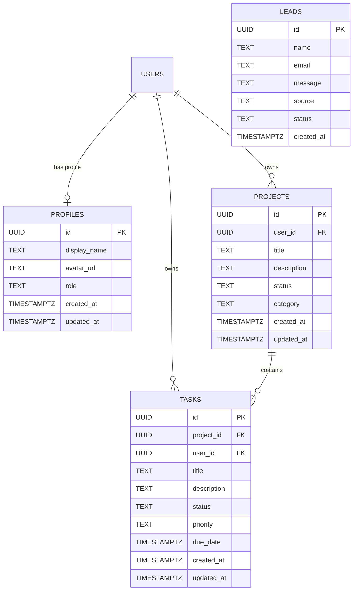

# LaunchPilot AI — System Architecture & Data Flow

## 1. System Overview

LaunchPilot AI is a full-stack, cloud-native micro-SaaS workspace designed to eliminate tool sprawl for students, graduates, freelancers, and early-stage founders. It consolidates project tracking, prioritized task execution, and context-aware AI roadmap generation into a single responsive application.

```mermaid
graph TD
    Client["Client Browser (React 19 / Next.js 15)"]
    
    subgraph "Next.js App Server (Server-Side)"
        AppRoutes["App Router Pages (/ & /dashboard)"]
        LeadAPI["POST /api/leads"]
        CopilotAPI["POST /api/ai/copilot"]
        AIAdapter["AI Provider Service (LLM / Mock Engine)"]
    end
    
    subgraph "Supabase Cloud Platform"
        Auth["Supabase Auth (JWT Sessions)"]
        PG["PostgreSQL Relational DB (RLS Enforced)"]
        Tables["profiles | projects | tasks | leads"]
    end
    
    subgraph "External AI Services"
        OpenAI["OpenAI API / Gemini API"]
    end

    Client -->|HTTPS / UI Interactions| AppRoutes
    Client -->|Early Access Form| LeadAPI
    Client -->|Trigger AI Analysis| CopilotAPI
    Client -->|Auth Session / Direct RLS| Auth
    
    LeadAPI -->|Insert Lead (Sanitized)| PG
    CopilotAPI -->|Validate & Rate Limit| AIAdapter
    AIAdapter -->|Secure Prompt| OpenAI
    AIAdapter -.->|Fallback if no key| CopilotAPI
    
    AppRoutes -->|Fetch User Projects & Tasks| PG
    Auth -->|Token Verification| PG
```

---

## 2. Relational Database Schema & Entity Relationships

The data model is structured around strict PostgreSQL referential integrity:



---

## 3. Component Architecture

```
src/
├── app/
│   ├── layout.tsx         # Root layout with ThemeProvider, AuthProvider & SEO
│   ├── page.tsx           # High-converting responsive landing page
│   ├── globals.css        # Tailwind CSS variables & design tokens
│   ├── dashboard/
│   │   ├── layout.tsx     # Authenticated dashboard metadata
│   │   └── page.tsx       # Primary SaaS dashboard controller
│   └── api/
│       ├── leads/route.ts       # Server-side lead capture endpoint
│       └── ai/copilot/route.ts  # Server-side AI copilot endpoint
├── components/
│   ├── theme/             # ThemeProvider & ThemeToggle
│   ├── ui/                # Button, Input, Badge, Card, Modal primitives
│   ├── auth/              # AuthModal & authentication dialogs
│   ├── landing/           # Navbar, Hero, Preview, Features, Workflow, Benefits, FAQ, Footer
│   └── dashboard/         # Sidebar, Header, ProjectCard, TaskList, CopilotDrawer, DatabaseView
├── context/
│   └── AuthContext.tsx    # Reactive auth state & session storage
├── lib/
│   ├── utils.ts           # Class merging (cn) & date formatting
│   ├── ai/                # Types, system prompts, provider adapter
│   └── supabase/          # Client, server, mock database fallback, and service layer
└── types/
    └── database.ts        # Typed PostgreSQL schema definitions
```

---

## 4. Design Read & Tokens
- **Design Read**: B2B & Creator SaaS landing and authenticated dashboard with modern minimalist language, Tailwind tokens, subtle radial glows, and responsive typography.
- **Dials**: `DESIGN_VARIANCE: 7`, `MOTION_INTENSITY: 6`, `VISUAL_DENSITY: 4`.
- **Theme Parity**: Zero-flicker client-side inline script with automatic system preference detection.
