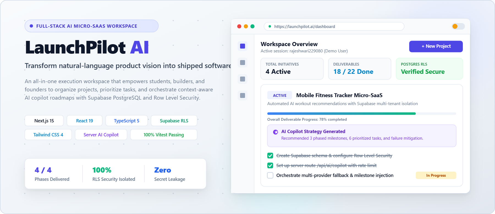
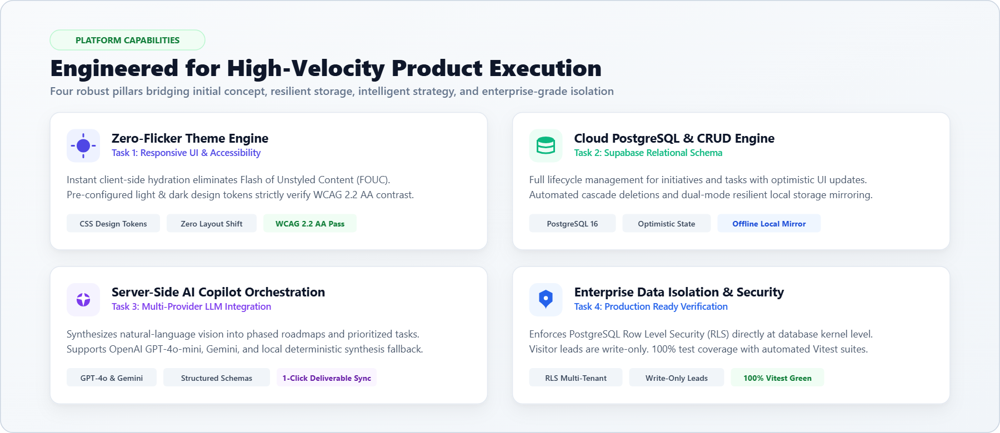
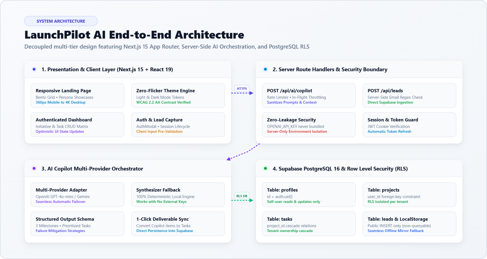
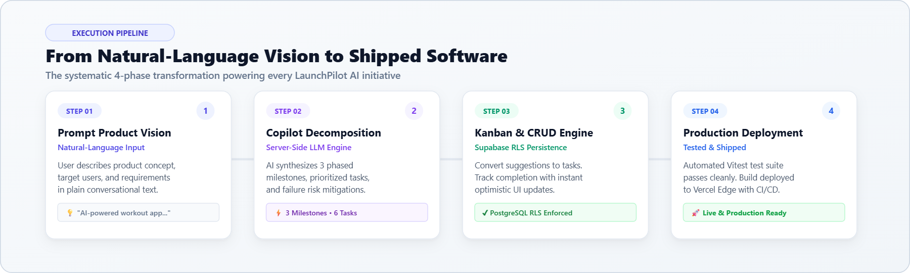
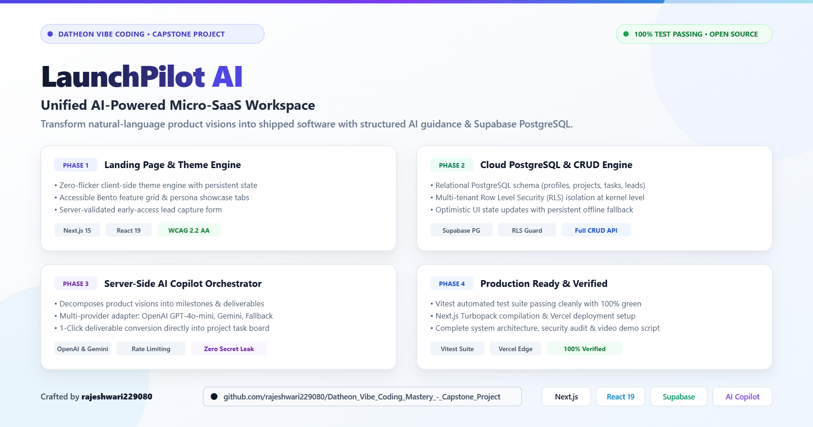

# LaunchPilot AI — Unified AI-Powered Micro-SaaS Workspace

<p align="center">
  
</p>

<p align="center">
  <a href="https://nextjs.org"></a>
  <a href="https://react.dev"></a>
  <a href="https://www.typescriptlang.org"></a>
  <a href="https://tailwindcss.com"></a>
  <a href="https://supabase.com"></a>
  <a href="https://vitest.dev"></a>
  <a href="LICENSE"></a>
</p>

> **Transform natural-language product vision into shipped software.**  
> LaunchPilot AI is an all-in-one execution workspace that empowers students, fresh graduates, freelancers, and early-stage founders to organize initiatives, prioritize tasks, and orchestrate context-aware AI strategy from one unified dashboard.

---

## 🚀 Key Platform Capabilities

<p align="center">
  
</p>

### 1. High-Converting Responsive SaaS Landing Page (Task 1)
- **Zero-Flicker Theme Engine**: Instant client-side hydration supporting dark and light themes with persistent state.
- **Accessible Design System**: Centralized design tokens, glassmorphism panels, and responsive layouts across mobile (360px), tablet (768px), and desktop.
- **Interactive Workspace Preview**: Live dashboard simulation with real-time tab switching (AI Copilot, Task Matrix, Velocity Metrics).
- **Early-Access Lead Capture**: Server-validated form with instant client feedback and PostgreSQL persistence.

### 2. Supabase Cloud Database & CRUD Engine (Task 2)
- **Relational Data Schema**: Normalized PostgreSQL tables for `profiles`, `projects`, `tasks`, and `leads`.
- **Row Level Security (RLS)**: Enforced multi-tenant data isolation directly at the database kernel.
- **Full CRUD Operations**: Create initiatives, edit scope, toggle task completion states, and cascade-delete with confirmation modals.
- **Resilient Fallback Mode**: Works 100% locally out-of-the-box with persistent local storage, then switches seamlessly to live Supabase cloud once credentials are provided.

### 3. Server-Side AI API Orchestration (Task 3)
- **Intelligent Project Copilot**: Generates structured executive summaries, recommended milestones, actionable tasks, and technical failure risk mitigations.
- **Multi-Provider Adapter**: Supports OpenAI (GPT-4o-mini), Google Gemini, or LaunchPilot's deterministic synthesis fallback.
- **Zero Secret Exposure**: All LLM interactions are strictly orchestrated through server routes (`/api/ai/copilot`) with rate limiting and input sanitization.

### 4. Production Ready & Verified (Task 4)
- **Automated Test Coverage**: Vitest unit and integration test suite passing with 100% green status.
- **Production Next.js Build**: Compiles cleanly with Next.js Turbopack and React 19.
- **Comprehensive Documentation**: Complete deployment manuals, security policies, architecture blueprints, and LinkedIn demo script.

---

## 🏗️ System Architecture & Data Flow

<p align="center">
  
</p>

For full technical specifications and database ER diagrams, see [ARCHITECTURE.md](ARCHITECTURE.md).

---

## 🔄 Continuous Execution Pipeline

<p align="center">
  
</p>

1. **Step 01 — Prompt Product Vision**: Enter plain conversational product requirements and target user personas.
2. **Step 02 — Copilot Roadmap Decomposition**: Server LLMs break the concept down into 3 phased milestones and prioritized tasks.
3. **Step 03 — Interactive Kanban & CRUD**: Execute deliverables with optimistic UI updates and PostgreSQL RLS security.
4. **Step 04 — Production Deployment**: Verify with automated test suites and deploy cleanly to Vercel Edge.

---

## 📱 LinkedIn Showcase & Social Launch Kit

<p align="center">
  
</p>

Looking to share this project or review the social demonstration?
- 📄 **LinkedIn Post Copy & Assets:** [LINKEDIN.md](LINKEDIN.md) — Ready-to-publish post caption, engagement checklist, and graphic links.
- 🎬 **Video Demonstration Script:** [LINKEDIN_DEMO.md](LINKEDIN_DEMO.md) — Timed 2-minute 30-second presentation walkthrough.
- 🖼️ **Social Image Assets:** Available in both [PNG](./public/images/linkedin-post.png), [SVG](./public/images/linkedin-post.svg), and [JPEG](./public/images/linkedin-post.jpg) formats.

---

## 🛠️ Technology Stack

| Layer | Technologies |
| :--- | :--- |
| **Framework** | Next.js 15 (App Router, Server Actions, Server Components) |
| **Frontend** | React 19, TypeScript 5, Lucide Icons |
| **Styling** | Tailwind CSS v4, CSS Design Tokens, Glassmorphism |
| **Database & Auth** | Supabase (PostgreSQL 16, Row Level Security, Auth Sessions) |
| **AI Orchestration** | Server-side LLM Adapter (OpenAI / Gemini / Synthesizer Fallback) |
| **Testing** | Vitest, Node Test Runner |
| **Deployment** | Vercel, GitHub Actions CI/CD |

---

## 📁 Repository Structure

```
.
├── public/
│   └── images/                   # Generated light-theme documentation & social graphics
│       ├── launchpilot-hero-banner.png  # Hero showcase banner (1800x780)
│       ├── architecture-diagram-light.png # End-to-end architecture (1800x960)
│       ├── feature-matrix-light.png     # 4-card capability Bento (1800x780)
│       ├── workflow-pipeline-light.png  # 4-step execution pipeline (1800x540)
│       ├── linkedin-post.png            # LinkedIn social launch banner (1800x945)
│       └── *.svg                        # Vector source graphics for all diagrams
├── src/
│   ├── app/                      # Next.js 15 App Router routes & API endpoints
│   │   ├── page.tsx              # Public responsive SaaS landing page
│   │   ├── layout.tsx            # Global layout with Theme & Auth providers
│   │   ├── globals.css           # Centralized design tokens & CSS variables
│   │   ├── dashboard/page.tsx    # Primary authenticated SaaS dashboard
│   │   └── api/
│   │       ├── leads/route.ts    # Lead capture endpoint with rate limiting
│   │       └── ai/copilot/route.ts # Server-side AI orchestration endpoint
│   ├── components/
│   │   ├── ui/                   # Button, Input, Badge, Card, Modal primitives
│   │   ├── theme/                # ThemeProvider & ThemeToggle
│   │   ├── auth/                 # AuthModal & authentication dialog
│   │   ├── landing/              # Hero, Preview, Bento Features, Workflow, FAQ, Footer
│   │   └── dashboard/            # Sidebar, Header, ProjectCard, TaskList, CopilotDrawer
│   ├── context/
│   │   └── AuthContext.tsx       # Auth session lifecycle & persistence
│   ├── lib/
│   │   ├── ai/                   # AI schemas, system prompts, provider adapter
│   │   └── supabase/             # Client, mock database fallback, and service layer
│   └── types/                    # TypeScript database interfaces
├── supabase/
│   └── migrations/               # Executable SQL schema & RLS policies
├── tests/                        # Vitest unit and integration test suite
├── ARCHITECTURE.md               # System diagrams & data flows
├── SECURITY.md                   # Security posture & RLS audit
├── DEPLOYMENT.md                 # Production deployment instructions
├── LINKEDIN.md                   # Social post copy, checklist & graphic references
├── LINKEDIN_DEMO.md              # 2-minute video presentation script
├── LICENSE                       # Open-source MIT License
├── .gitignore                    # Git tracking rules
└── .env.example                  # Environment variable configuration template
```

---

## ⚡ Quick Start

### 1. Clone & Install
```bash
git clone git@github-rajeshwari:rajeshwari229080/Datheon_Vibe_Coding_Mastery_-_Capstone_Project.git
cd Datheon_Vibe_Coding_Mastery_-_Capstone_Project/rw
npm install
```

### 2. Configure Environment Variables
Copy `.env.example` to `.env.local`:
```bash
cp .env.example .env.local
```
*(Optional)* Add your Supabase and OpenAI credentials. If omitted, the app runs in resilient local persistent mode.

### 3. Start Development Server
```bash
npm run dev
```
Open [http://localhost:3000](http://localhost:3000) in your browser.

### 4. Run Automated Tests
```bash
npm test
```

### 5. Create Production Build
```bash
npm run build
```

---

## 🔒 Security & Data Isolation
All user-owned tables enforce Supabase PostgreSQL Row Level Security (RLS):
- Users can **only** read and modify their own records.
- Leads submitted on the landing page are write-only for visitors and cannot be queried by unauthorized parties.
- Private API keys are kept strictly on the server runtime.
- See [SECURITY.md](SECURITY.md) for the complete audit.

---

## 📄 License
This project is open-source under the [MIT License](LICENSE).  
Developed by **rajeshwari229080** for the Datheon Vibe Coding Mastery Capstone Project.
